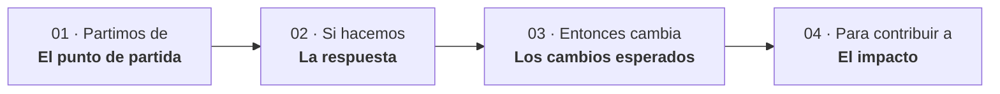
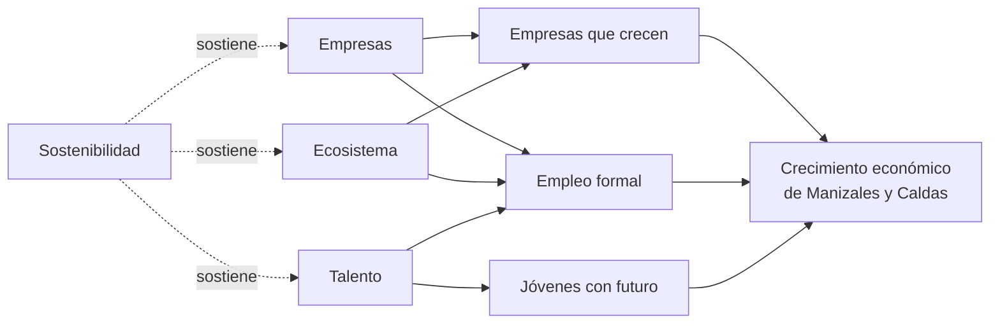

# Teoría de cambio de Manizales Más

> **Que en Caldas crecer sea la regla, no la excepción.**

Sistema en línea de la teoría de cambio de Manizales Más, versión 9.0 (noviembre de 2026).

**Consulta el sistema:** [jcmorab.github.io/mel_manizales_mas](https://jcmorab.github.io/mel_manizales_mas/)

Manizales Más nació en 2012 con una apuesta poco común para una ciudad intermedia: medir el éxito por cuántas empresas logran crecer, y no por cuántas se crean. Desde entonces trabaja junto a empresarios, universidades, gremios y gobierno, de la mano de Babson College y más tarde del MIT, para que en Manizales y Caldas crecer sea más fácil, más frecuente y más ambicioso.

Este repositorio publica la segunda versión de la teoría de cambio que el programa viene desarrollando. Incluye los problemas que atiende, lo que hacen sus programas, los cambios que espera ver y el impacto al que contribuye.

---

## Del reto que enfrentamos al Caldas que queremos

La teoría de cambio se recorre en cuatro pasos, en el mismo orden en que ocurre el cambio.

| Paso | Contenido |
|---|---|
| **01 · El punto de partida** | El reto de Caldas, los marcos que nos guían, lo que hemos logrado y el entorno de las empresas. |
| **02 · La respuesta** | Cuatro frentes de trabajo y los programas que los hacen posibles. |
| **03 · Los cambios esperados** | Lo que debe cambiar en las empresas, en el entorno y en los jóvenes. |
| **04 · El impacto** | A lo que contribuyen los cuatro frentes juntos. |

---

## 01 · El punto de partida

### Crecer sigue siendo la excepción

Menos peso en la economía, empresas que no perduran y jóvenes sin trayectorias estables.

| Dimensión | Dato | Contexto |
|---|---|---|
| **Peso en la economía nacional** | **1,7 de cada 100** pesos del PIB nacional se producen en Caldas, la mitad que en los años sesenta (3,5). | PIB por habitante 2025: 30,0 millones de pesos en Caldas frente a 34,9 en Colombia. |
| **Supervivencia empresarial** | **1 de cada 4** empresas creadas en 2019 seguía activa cinco años después (24,9 %). | Promedio nacional: 32 %. |
| **Empleo juvenil** | **2 de cada 10** jóvenes de 18 a 25 años que buscan empleo en Manizales no lo encuentran (17,7 %), el doble del promedio. | Los jóvenes permanecen en promedio 1,3 años en el mismo empleo, frente a 6,7 años del total. |

### Los marcos en los que nos apoyamos

Esta teoría de cambio se apoya en el método de Babson College y del MIT.

| Marco | Aporte |
|---|---|
| **Babson College** · Entrepreneurship Ecosystem Project | El enfoque de ecosistema: un ecosistema se construye alrededor de las empresas que crecen y se entiende en seis dimensiones. |
| **MIT REAP** · Regional Entrepreneurship Acceleration Program | La mirada de actores: empresarios, capital, empresas ancla, gobierno y universidades trabajando sobre apuestas comunes. |
| **MIT Venture Mentoring Service** · Modelo de mentoría | El modelo de mentoría en equipo, con empresarios voluntarios que acompañan por hitos. |

### Resultados que respaldan el modelo

| | 2012-2017 · Primeros cinco años | 2024 · Cohorte más reciente |
|---|---|---|
| Empresas de alto potencial | 73 | 17 |
| Crecimiento promedio | **46 %** | **24 %** |
| Otros resultados | 1.392 empleos nuevos · 1.679 clientes nuevos · 8 empresas exportadoras | 11 de 17 crecieron a dos dígitos · 358 empleos directos e indirectos · 247 clientes nuevos |

Además, 51 mentores empresariales han acompañado a 188 empresas de alto potencial.

### El ecosistema que rodea al empresario

Una empresa no crece sola. El modelo trabaja sobre seis dimensiones, adaptadas a Manizales a partir del modelo de Babson College:

| Dimensión | Qué significa |
|---|---|
| **Política** | Las reglas y el liderazgo público que facilitan crear empresas y hacerlas crecer. |
| **Finanzas** | El capital disponible para cada etapa de una empresa. |
| **Cultura** | Lo que la sociedad piensa y valora sobre emprender y crecer. |
| **Soporte** | Las organizaciones y servicios que acompañan a las empresas. |
| **Trabajo y talento** | Las personas formadas que las empresas necesitan para crecer. |
| **Mercados** | Los clientes y las redes que abren oportunidades de venta. |

---

## 02 · La respuesta

Cuatro frentes de trabajo. Los tres primeros atienden a las empresas, su entorno y el talento que necesitan; el cuarto sostiene a los otros tres.

| Frente | Qué atiende | Programas |
|---|---|---|
| **Empresas** | Las empresas que pueden crecer. | Empresas de Alto Potencial · Crecer Más · Vender Más · Mentoría Empresarial · Addventure Más · Lanza Más |
| **Ecosistema** | El entorno que las rodea. | Desarrollo de ecosistema · Open Más · Nevado Capital · Entrenamiento a mentores · Profesores de Alto Potencial · La ruta del emprendimiento |
| **Talento** | El talento que necesitan. | Qué Nivel |
| **Sostenibilidad** | Hace que todo esto dure: sostiene a los otros tres frentes. | AuRA y pago por resultados · Lleva el crecimiento a tu región |

---

## 03 · Los cambios esperados

Cada frente sigue la misma lógica: de qué problema partimos, cuál es la apuesta y qué debe cambiar.

### Empresas

- **Partimos de:** empresas con potencial que no logran crecer de forma sostenida.
- **La apuesta:** si las empresas con potencial se entrenan, reciben mentoría y se conectan, mejoran su gestión, venden más y generan empleo formal.
- **Entonces cambia:**
  1. Empresas que ejecutan sus decisiones de crecimiento.
  2. Empresas que crecen en clientes, capacidad y caja.
  3. Empresas y emprendimientos que siguen en pie.

### Ecosistema

- **Partimos de:** un entorno que no facilita crecer.
- **La apuesta:** si los actores del ecosistema avanzan juntos, crecer se vuelve más fácil y pasa a ser una aspiración compartida.
- **Entonces cambia:**
  1. Un ecosistema más fuerte en sus seis dimensiones.
  2. Más capital y más mercado para las empresas.
  3. Una cultura que valora crecer y retribuye.

### Talento

- **Partimos de:** jóvenes de Manizales con bajo acceso a oportunidades reales de empleo formal o de emprendimiento sostenible, y un ecosistema desarticulado que fragmenta las rutas de inserción.
- **La apuesta:** si a la formación se suma una intermediación real con las empresas, los jóvenes construyen trayectorias laborales que perduran.
- **Entonces cambia:**
  1. Jóvenes con capacidad de agencia para influir en su trayectoria productiva.
  2. Jóvenes con trayectorias laborales exitosas, por empleo o por emprendimientos fortalecidos.
  3. Empresas que adoptan modelos de vinculación, adaptación y permanencia de talento joven.
  4. Empresas y jóvenes conectados para promover oportunidades de negocio y empleabilidad.
  5. Actores del ecosistema articulados en torno a agendas de inclusión productiva.

### Sostenibilidad

- **Partimos de:** un modelo que depende de pocas fuentes de financiación.
- **La apuesta:** si Manizales Más lleva su modelo a otros territorios y diversifica sus ingresos, puede sostener y ampliar los otros tres frentes.
- **Entonces cambia:**
  1. Otros territorios operan el modelo por su cuenta.
  2. Manizales Más se sostiene con ingresos diversos.
  3. Una comunidad activa que respalda el modelo.

---

## 04 · El impacto

**Crecimiento económico de Manizales y Caldas:** más empresas que crecen con rentabilidad y siguen en pie, más empleo formal y más jóvenes con una inclusión productiva y gratificante.

| Pilar | Qué esperamos |
|---|---|
| **Empresas que crecen** | Crecen en ventas, capacidad y caja, y siguen en pie dos años después. |
| **Empleo formal** | Más empleo formal y mejor pagado, que crece con las empresas que acompañamos. |
| **Jóvenes con futuro** | Una inclusión productiva y gratificante: ocupación, formalidad, permanencia y bienestar. |

---

## Lo que aporta cada aliado

Seis tipos de aliados, un mismo propósito.

| Aliado | Aporte |
|---|---|
| **Empresarios** | Acompañan como mentores a las empresas que vienen detrás. |
| **Empresas ancla** | Abren sus compras a empresas locales y sus puertas a los jóvenes. |
| **Inversionistas y financiadores** | Invierten en empresas con potencial y financian contra resultados. |
| **Universidades** | Forman a docentes y estudiantes para emprender y crecer. |
| **Gobierno** | Lleva el modelo a los municipios de Caldas. |
| **Gremios y entidades de soporte** | Miden el ecosistema y articulan las apuestas regionales. |

---

## Una teoría de cambio que también crece

El modelo completo está en línea y se actualiza a medida que avanza el trabajo con los aliados. En el [sistema](https://jcmorab.github.io/mel_manizales_mas/) se encuentran:

- las cadenas causales de los cuatro frentes, de las actividades a los productos, los resultados y el impacto;
- las hipótesis, los supuestos y la evidencia de cada paso;
- un sistema de indicadores que se sigue ampliando, con su forma de cálculo, su fuente y su frecuencia.

## Estructura del repositorio

| Archivo | Contenido |
|---|---|
| `index.html` | Sistema completo de la teoría de cambio, en un solo archivo. Se publica con GitHub Pages. |
| `TdC_Manizales_Mas_v9.0.pptx` | Presentación de difusión de la teoría de cambio para aliados. |
| `README.md` | Este documento. |

Para ver el sistema en local basta con abrir `index.html` en un navegador.

## Fuentes de los datos

- Banco de la República, *Composición de la economía de la región Eje Cafetero de Colombia*, Ensayos sobre Economía Regional n.º 54 (participación promedio por década en el PIB nacional, con base en Inandes, CEGA y DANE).
- DANE, PIB departamental 2025 (preliminar).
- Cámara de Comercio de Manizales por Caldas, Informe Económico Anual (supervivencia de la cohorte de empresas creadas en 2019).
- Confecámaras y BID Invest, 2025 (supervivencia empresarial nacional).
- Manizales Más, programa Qué Nivel, con base en DANE, Gran Encuesta Integrada de Hogares 2025 (Manizales AM, promedio anual).
- Babson College, 2017. *Manizales Más Celebrates Five Years of Fostering Growth, Employment, and Prosperity Among the Local Entrepreneurial Ecosystem*.
- Fundación Luker, Reporte de sostenibilidad 2025, Emprendimiento (resultados con corte a 2024).

## Cómo citar

Manizales Más (2026). *Teoría de cambio de Manizales Más*, versión 9.0. Disponible en https://jcmorab.github.io/mel_manizales_mas/
